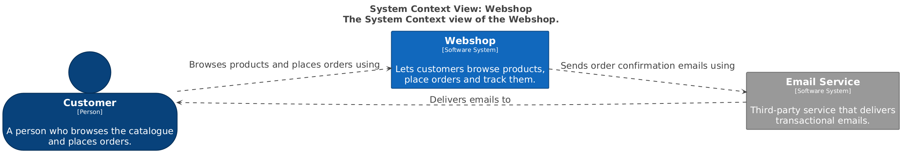
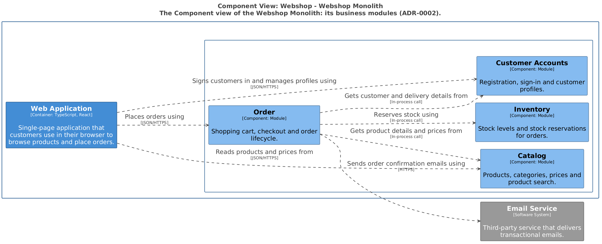
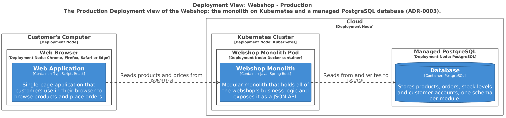
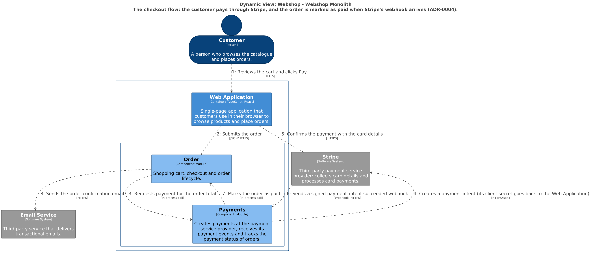
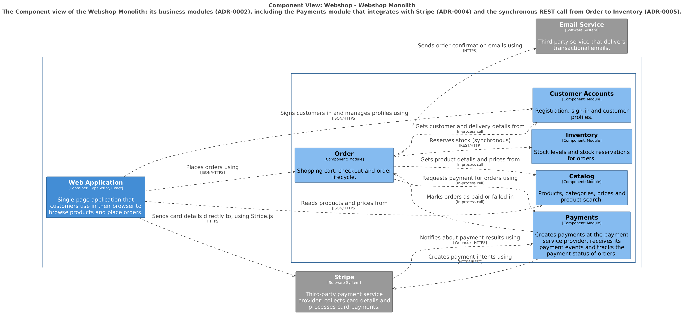
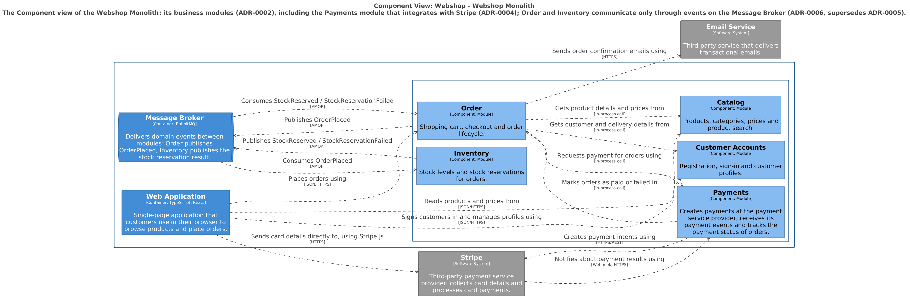
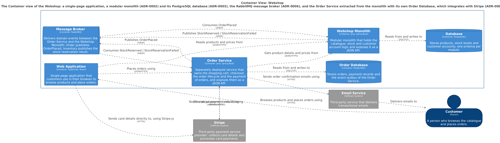

# C4 + ADR demo

A demo repository showing how the [C4 model](https://c4model.com/) and
[Architecture Decision Records](https://adr.github.io/) (ADRs) work together in one
repository.

The story is told through an imaginary **webshop**. Every architectural decision is
recorded as an ADR, and the C4 model (written in [Structurizr DSL](https://docs.structurizr.com/dsl))
changes in the same pull request as the decision that justifies it.

Three ideas run through the whole repository:

1. ADRs and C4 diagrams change together, in one pull request.
2. A decision drives a diagram change: the ADR explains *why* the C4 model changed.
3. Docs as code: the architecture lives next to the code, reviewed, versioned and enforced by CI.

There is no application code here, only documentation and CI.

## Walkthrough

> ⏱️ **Estimated time: 10–15 minutes.** Read this section top to bottom and open each
> link as you go. Every step is one pull request, in ADR order.

### Two ideas in two minutes

**The C4 model** is a way to draw software architecture at four zoom levels, like a map
you can zoom into: **Context** (the system and the people and systems around it),
**Containers** (the applications and databases it is made of), **Components** (the
modules inside one container) and **Code**. Instead of one big diagram, you get a few
small ones, each answering one question. Here the model is written as text in
[Structurizr DSL](https://docs.structurizr.com/dsl), and the diagrams are generated from it.

**An Architecture Decision Record (ADR)** is a short text file that records one
important decision: the context (what problem we had), the options we considered, what
we decided and what it costs us. ADRs are numbered and never deleted. When a decision
changes, a new ADR *supersedes* the old one, so you can always see why the system looks
the way it does. This repository uses the [MADR](https://adr.github.io/madr/) format.

The point of this repository is that the two belong together: the ADR says **why**, the
C4 diagram shows **what** changed, and both arrive in the same pull request.

### What to look for in each pull request

Every pull request below has the same four parts. Open them in this order:

1. **The ADR**: the new file in `docs/architecture/decisions/` (*Files changed* tab).
   Read the context, the options and the consequences.
2. **The DSL diff**: the change to `docs/architecture/workspace.dsl` in the same tab.
   This is the model change the decision drives.
3. **The bot comment**, *Diagram preview* (*Conversation* tab): **Before** and
   **After** images of every view that changed, rendered by CI. You don't need to read
   the DSL to see what changed.
4. **The review comments**: a tech lead, an SRE lead and a security lead each look at
   the same decision from their own angle, the way a real architecture review works.

### Step 1: ADR-0001, record architecture decisions

The first commit on `main`: the walking skeleton, merged in
[PR #13](https://github.com/letscodehu/c4-adr/pull/13). It adds
[ADR-0001](https://github.com/letscodehu/c4-adr/blob/main/docs/architecture/decisions/0001-record-architecture-decisions.md)
("we will record architecture decisions as ADRs"), the first C4 view (System Context:
a customer, the Webshop and an Email Service), the `validate` CI and the GitHub Pages
site.

**Look at:** how short the ADR is, and the System Context view: the whole system is
one box. Every later step zooms into it.



### Step 2: ADR-0002, start with a modular monolith

[PR #21](https://github.com/letscodehu/c4-adr/pull/21): one small team, domain
boundaries still moving. The decision is **one deployable backend, split into modules**
(Catalog, Order, Inventory, Customer Accounts) instead of microservices from day one.

**Look at:** the ADR's rejected options (microservices, a layered monolith); the DSL
diff that adds the Web Application, the Webshop Monolith and its components; the bot
comment, where the Containers and Components views are marked *new view*; and the tech
lead's review comment that `Order` already depends on all three other modules. Keep
that in mind until step 7.



### Step 3: ADR-0003, use PostgreSQL

[PR #22](https://github.com/letscodehu/c4-adr/pull/22): orders and stock must change
together, in one transaction. The decision is **managed PostgreSQL**, one schema per
module.

**Look at:** the DSL diff that adds the `Database` container and the first
**Deployment** view (a new view in the bot comment); the SRE lead asking about restore
tests, and the security lead insisting on encryption at rest.



### Step 4: ADR-0004, payments via an external PSP (Stripe)

[PR #23](https://github.com/letscodehu/c4-adr/pull/23): card payments bring PCI DSS
compliance. The decision is **Stripe**: card details go from the browser straight to
Stripe and never touch the Webshop.

**Look at:** the new external system on every view, and the new **Checkout** dynamic
view, which numbers the steps of a checkout; the ADR openly accepting vendor lock-in;
and the SRE lead's question: what does checkout do when Stripe is down?



### Step 5: ADR-0005, synchronous REST between Order and Inventory

[PR #24](https://github.com/letscodehu/c4-adr/pull/24): two customers must not buy
the last item in stock. The decision is that **`Order` calls `Inventory`'s REST API and
waits** for the reservation: simple, with an immediate answer.

**Look at:** the **Consequences** section of the ADR, which already names the price:
checkout is only as available as `Inventory`. The ADR accepts this "for now". Then
the `REST/HTTP` label on the `Order` → `Inventory` arrow in the bot comment, and the
SRE lead's comment on the same risk.

### Step 6: ADR-0006, introduce an event bus (RabbitMQ), superseding ADR-0005

[PR #25](https://github.com/letscodehu/c4-adr/pull/25): during a sales peak, the
risk from step 5 became real. A slow `Inventory` took checkout down. The decision is
**RabbitMQ events** instead of the synchronous call.

**Look at:** how decisions change over time. ADR-0006 says *Supersedes ADR-0005*, and
ADR-0005 is **not deleted**: only its status changes to *Superseded by ADR-0006*
(*Files changed* shows both ADRs). In the bot comment, the direct `Order` →
`Inventory` arrow disappears from the Components view and events through the new
`Message Broker` replace it:

| Before (ADR-0005) | After (ADR-0006) |
| --- | --- |
|  |  |

### Step 7: ADR-0007, extract Order into a separate service (proposed, open PR)

[PR #26](https://github.com/letscodehu/c4-adr/pull/26) is **open on purpose and will
never be merged**: ADR-0007 is *Proposed*, still under discussion. It proposes moving
`Order` and `Payments` out of the monolith into their own service and database.

**Look at:**

- **The red → green run.** Open the *Commits* tab. The first commit,
  [`0f341fa`](https://github.com/letscodehu/c4-adr/pull/26/commits/0f341fac639161712933cdee4678011e65bc4a8d),
  changes only the DSL, and `adr-guard`
  [**failed**](https://github.com/letscodehu/c4-adr/actions/runs/44751149301): a model
  change without a decision is not allowed. The second commit,
  [`b1ebac4`](https://github.com/letscodehu/c4-adr/pull/26/commits/b1ebac4c02bfe8f9febb417e9f01f65e093b9933),
  adds the ADR, and `adr-guard`
  [**passes**](https://github.com/letscodehu/c4-adr/actions/runs/44751404735).
- **The review comments**: the tech lead says *not yet, let's measure first*, the SRE
  lead asks who pays for a second database, the security lead wants service-to-service
  authentication settled first. This is what an undecided decision looks like.



### Step 8: the published site

Everything merged to `main` is published to GitHub Pages as two sites: the diagrams at
**<https://letscodehu.github.io/c4-adr/>** and the decisions at
**<https://letscodehu.github.io/c4-adr/adr/>**. This is what you would share with people
who never open a pull request.

**Look at:**

- The **views**, built from the same DSL:
  [System Context](https://letscodehu.github.io/c4-adr/main/webshop/context/),
  [Containers](https://letscodehu.github.io/c4-adr/main/webshop/container/),
  [Components](https://letscodehu.github.io/c4-adr/main/webshop/component/webshop-monolith/),
  [Deployment](https://letscodehu.github.io/c4-adr/main/webshop/deployment/) and the
  [Checkout](https://letscodehu.github.io/c4-adr/main/webshop/dynamic/) dynamic view.
- The **decisions** ([ADR site](https://letscodehu.github.io/c4-adr/adr/), built with
  [log4brains](https://github.com/thomvaill/log4brains)): ADR-0001 to ADR-0006 on a
  timeline, with their status and full-text search (try "RabbitMQ"). ADR-0005 is marked
  *superseded* with a link to ADR-0006, and ADR-0006 links back with *Supersedes
  ADR-0005*. ADR-0007 is not here: it is still in an open pull request, not on `main`.

### For tech leads and architects

The rule "every model change needs a decision" is not a convention here; CI enforces it.
The [`adr-guard`](#adr-guard) workflow compares the C4 model of the pull request with
the base branch, and fails if the model changed without an added or modified ADR, or if
an ADR changed without a model change. Step 7 shows it failing. The [`diagrams`](#diagrams)
workflow puts Before / After images in every pull request, so reviewers can judge a
change without reading DSL, and `validate` and `pages` keep the DSL valid and the
published site current. The details are in [How the CI works](#how-the-ci-works).

The layout (`docs/architecture/workspace.dsl`, `decisions/` published with log4brains,
and the four workflows) can serve as the starting point of a template repository for your
own teams. This repository is a demo, not a template: copy what you need.

## Published site

One `pages` workflow run publishes two static sites to GitHub Pages:

| Site | URL | Built with |
| --- | --- | --- |
| The C4 views (diagrams) | **<https://letscodehu.github.io/c4-adr/>** | [Structurizr site generatr](https://github.com/avisi-cloud/structurizr-site-generatr) from `workspace.dsl` |
| The ADRs (decisions) | **<https://letscodehu.github.io/c4-adr/adr/>** | [log4brains](https://github.com/thomvaill/log4brains) from `docs/architecture/decisions/` |

The ADR site has a decision timeline, full-text search and the *superseded* links; its
home page links back to the diagrams. The old `main/decisions/` page of the Structurizr
site redirects to the ADR site.

## Repository structure

```
docs/
  architecture/
    workspace.dsl            # Structurizr DSL workspace (C4 model + views)
    decisions/               # ADRs in MADR format, published with log4brains
      0001-record-architecture-decisions.md
    adr-index.md             # home page of the log4brains ADR site
.log4brains.yml              # log4brains configuration (project name, ADR folder)
.github/
  workflows/
    validate.yml             # validates the DSL on every pull request and push to main
    pages.yml                # builds the Structurizr and log4brains sites and deploys them to GitHub Pages
    adr-guard.yml            # fails a pull request that changes the model without an ADR, or vice versa
    diagrams.yml             # renders the views and comments Before / After images on every pull request
  scripts/
    export-workspace.sh      # exports the workspace of any git revision with the Structurizr CLI
    model-diff               # compares the C4 model of two JSON exports (text, or --json)
    highlight-diff           # tags and styles the model differences in a JSON export
    render-views             # renders every view of a git revision to PNG and SVG, optionally highlighted
    publish-previews         # pushes rendered images to the orphan diagram-previews branch
    preview-comment          # builds the Before / After diagram preview comment
    log4brains-prepare       # adapts the ADR format for log4brains in the CI checkout
    tests/                   # unit tests and fixtures for the scripts above
```

Rendered images are never committed to `main`. They are produced by CI and published to
GitHub Pages, to workflow artifacts and to the orphan `diagram-previews` branch (see
[diagrams](#diagrams)).

## How the CI works

| Workflow | Runs on | What it does |
| --- | --- | --- |
| `validate` | every pull request, push to `main` | Validates `workspace.dsl` with the Structurizr CLI. |
| `pages` | push to `main`, manual (`workflow_dispatch`) | Builds the Structurizr site (C4 views) and the log4brains site (ADRs, under `/adr/`) and deploys both to GitHub Pages in one artifact (see below). |
| `adr-guard` | every pull request | Checks that model changes and ADR changes go together (see below), and runs the unit tests of the CI scripts. |
| `diagrams` | every pull request | Renders every view before and after the pull request, and keeps one bot comment with Before / After images up to date (see below). |

### adr-guard

The rule: **the C4 model changes if and only if the pull request adds or modifies an ADR**
in `docs/architecture/decisions/`.

| Model changed? | ADR added or modified? | Result |
| --- | --- | --- |
| yes | yes | ✅ pass |
| no | no | ✅ pass (e.g. README or CI changes) |
| yes | no | ❌ fail: a model change needs a decision |
| no | yes | ❌ fail: a decision without a model change |

How it works: the workflow exports the workspace of the base revision (the merge base
with the target branch, checked out into a temporary `git worktree`) and of the pull
request to JSON with the Structurizr CLI, and `.github/scripts/model-diff` compares the
`model` part of the two exports. ADR changes are detected with
`git diff --name-only --diff-filter=AM origin/<base>...HEAD -- docs/architecture/decisions/`.
Only the presence of an added or modified ADR file is checked, not its content.

**Counts as a model change:**

- an added or removed element: person, software system, container, component,
  deployment node, infrastructure node, software system or container instance;
- an added or removed relationship;
- a changed name, description, technology, tag, URL, group, property or perspective of
  an element or relationship (for example a new tag on a deployment node).

**Does not count as a model change:**

- anything in `views`: new or removed views, `include`/`exclude`, `autolayout`,
  descriptions of views;
- `styles` (colours, shapes) and other `configuration`;
- the ADRs and documentation themselves;
- generated ids and the order in which elements, relationships or tags are declared;
- renaming a DSL identifier (the variable name, stored by Structurizr as the
  `structurizr.dsl.identifier` property), because it does not change the architecture;
- implied relationships that Structurizr derives from an explicit one (the explicit
  relationship is compared instead).

**If adr-guard is red**, open the failed run: the first line of the log and the job
summary say which case you hit, list every model difference (`+` added, `-` removed,
`~` changed) and the ADRs touched, and say what to do:

- *Model changed, no ADR:* add an ADR (`docs/architecture/decisions/NNNN-kebab-title.md`,
  MADR format) that explains why the model changes, or update the ADR this change
  implements. If the model change was not intended, revert it.
- *ADR changed, model did not:* add the model change the decision drives to
  `workspace.dsl` in the same pull request, or move the ADR edit into the pull request
  that changes the model.

Run the `model-diff` tests and the comparison locally (Docker and Python 3 needed):

```sh
python3 -m unittest discover -s .github/scripts/tests -v

.github/scripts/export-workspace.sh origin/main json build/base
.github/scripts/export-workspace.sh --working-tree json build/head
.github/scripts/model-diff build/base/workspace.json build/head/workspace.json
```

### diagrams

Every pull request gets **one** bot comment, *Diagram preview*, that shows what the
pull request does to the diagrams. Every push to the pull request updates the same
comment with the new images instead of adding another one.

- A view that **changed** gets a two-column table: **Before** (the base branch) and
  **After** (the pull request).
- A **new view** says "new view" in the Before column, a **removed** view says
  "removed" in the After column.
- Unchanged views are collapsed in a `<details>` block at the end.
- If nothing changed, the comment says **No diagram changes**.

The Before / After images **highlight the model changes** of the pull request. Only the
border of an element and the line of a relationship change; the fill colour and the shape
(database cylinder, queue, person, ...) stay as the workspace `styles` define them:

| Mark | Image | Meaning |
| --- | --- | --- |
| 🟩 green, thick border / solid line | After | new element or relationship |
| 🟧 orange, thick border / solid line | After | changed element or relationship (description, technology, tag, ...) |
| 🟥 red, thick dashed border / line | Before | removed element or relationship |

When at least one image is highlighted, the comment has a one-line legend above the
tables. A pull request that changes only `views` or `styles` (no model change) has no
highlighting and no legend. This works on every view type (System Context, Container,
Component, Deployment, Dynamic), wherever the element or relationship is drawn:

- an implied relationship on a higher-level view (e.g. a new component relationship
  shown between two containers or systems) is marked like the explicit one it comes from;
- the deployment instances of a changed container or software system are marked too,
  as they show its name and description;
- a relationship whose description changed counts as *changed* (orange), even though
  adr-guard lists it as one removed and one added relationship.

The highlighting is for review only: the GitHub Pages site and the plain images in the
workflow artifact are not highlighted.

How it works:

1. `.github/scripts/render-views` renders every view of the base revision (the merge
   base with the target branch, the same one adr-guard uses) and of the pull request.
   It exports the workspace with `export-workspace.sh` as `plantuml/structurizr`
   (this flavour keeps the colours and shapes of the workspace `styles`) and renders
   each view to PNG and SVG with the `plantuml/plantuml` Docker image.
   With `--compare-to <base-rev>` (After side) or `--removed-in <head-rev>` (Before
   side), it also writes a highlighted `<view-key>.diff.png` (and `.svg`, `.puml`) for
   every view that shows a model difference: it exports both revisions as JSON,
   `model-diff --json` lists the added, changed and removed elements and relationships
   with their ids (and the implied relationships and deployment instances that belong to
   them), `highlight-diff` adds a `Diff: Added` / `Diff: Changed` / `Diff: Removed` tag
   and a matching style to them in the JSON, and that JSON is exported as
   `plantuml/structurizr` and rendered again. The workspace DSL is never modified.
2. A view counts as changed when its **plain** (not highlighted) PlantUML source
   differs, so anything drawn on it counts: elements, relationships, descriptions,
   styles, layout, title. The highlighting never makes a view count as changed, and
   unchanged views always show the plain image.
3. All PNG, SVG and PlantUML files, plain and highlighted, are uploaded as the
   `diagrams-pr-<number>-<short-sha>` **workflow artifact**: open the run from the
   comment's footer link (or the PR's Checks tab) to download them.
4. `.github/scripts/publish-previews` pushes the images to the **orphan
   `diagram-previews` branch**, to `pr-<number>/<short-sha>/base/<view-key>.png` and
   `pr-<number>/<short-sha>/head/<view-key>.png` (and `.diff.png`, `.svg`, `.diff.svg`). If several pull requests
   push at the same time, a rejected push is rebuilt on the new tip of the branch and
   retried. The workflow creates the branch on its first run.
5. `.github/scripts/preview-comment` builds the comment, with images linked from
   `https://raw.githubusercontent.com/letscodehu/c4-adr/diagram-previews/...`. The
   workflow finds its earlier comment by the hidden `<!-- diagram-preview -->` marker
   and edits it, or creates it on the first run.

**Why no images on `main`?** Generated files in the main history only add noise: every
model change would come with binary diffs, and the images could drift from the DSL
they were rendered from. The DSL is the source of truth; images are build output. The
comment still needs a stable URL for each image, and a workflow artifact cannot be
embedded in a comment, so the images live on `diagram-previews`, a branch that shares
no history with `main` and is never merged. Each push gets its own `<short-sha>`
folder, so older comment versions keep their images.

Not covered (yet): pull requests from forks (their token cannot push or comment, so the
job is skipped) and cleaning up `diagram-previews` after pull requests are closed.

Render the views and build the comment locally (Docker and Python 3 needed):

```sh
python3 -m unittest discover -s .github/scripts/tests -v

.github/scripts/render-views --removed-in --working-tree origin/main build/diagrams/base
.github/scripts/render-views --compare-to origin/main --working-tree build/diagrams/head
.github/scripts/preview-comment build/diagrams/base build/diagrams/head base head
```

### pages

`.github/workflows/pages.yml` runs on every push to `main` and on demand (*Actions* →
`pages` → *Run workflow*). One job builds both sites into `build/site`, and one Pages
deployment publishes them together:

1. The Structurizr site generatr builds the C4 views from `workspace.dsl` into
   `build/site` (the site root, the views are under `main/`).
2. log4brains (pinned version, pinned Node.js, run with `npx`, no `package.json`)
   builds the ADR site from `docs/architecture/decisions/` into `build/site/adr`, with
   `docs/architecture/adr-index.md` as its home page. It needs the full git history
   (`fetch-depth: 0`) for the dates and authors it shows.
3. The old, now empty `main/decisions/` page of the Structurizr site is replaced by a
   redirect to `/adr/`.

**Why `log4brains-prepare`?** log4brains reads the status and date from the MADR header
list (`* Status: ...`, `* Date: ...`), so before the build the script adapts the ADRs
**in the CI checkout only** (never committed), without changing their content:

- It removes the YAML front matter (`status:`, `date:`): log4brains does not read it,
  and in front of the title it hides the header list. The header list repeats the same
  values.
- In `* Status: Superseded by [ADR-0006: ...](0006-....md)` it uses the file slug as the
  link text: log4brains takes the superseding ADR from that text.
- It moves the Status and Date items in front of other header items such as
  `* Supersedes: ...`, so the list renders correctly after log4brains removes them.

So ADRs keep their current format (front matter included): a new ADR shows up
on the ADR site after it is merged (or after a manual run of `pages`), with no extra
step.

## Running locally

You need Docker, and Node.js 22 for the ADR site. Run the commands from the repository
root.

Validate the DSL:

```sh
docker run --rm -v "$PWD:/usr/local/structurizr" structurizr/cli:2025.11.09 \
  validate -workspace docs/architecture/workspace.dsl
```

Generate the static site into `build/site` (git-ignored):

```sh
docker run --rm -v "$PWD:/var/model" ghcr.io/avisi-cloud/structurizr-site-generatr:1.6.0 \
  generate-site --workspace-file docs/architecture/workspace.dsl \
  --default-branch main --output-dir build/site
```

Then open `build/site/index.html` in a browser, or serve it with live reload:

```sh
docker run --rm -p 8080:8080 -v "$PWD:/var/model" ghcr.io/avisi-cloud/structurizr-site-generatr:1.6.0 \
  serve --workspace-file docs/architecture/workspace.dsl
```

and browse to <http://localhost:8080>.

Preview the ADR site with live reload. `log4brains-prepare` changes the ADR files in
place, so run it in a throwaway clone (inside the git-ignored `build/`), never in your
working copy:

```sh
git clone . build/adr-preview
cd build/adr-preview
.github/scripts/log4brains-prepare docs/architecture/decisions
cp docs/architecture/adr-index.md docs/architecture/decisions/index.md
npx --yes log4brains@1.1.0 preview
```

## License

[MIT](LICENSE.md)
